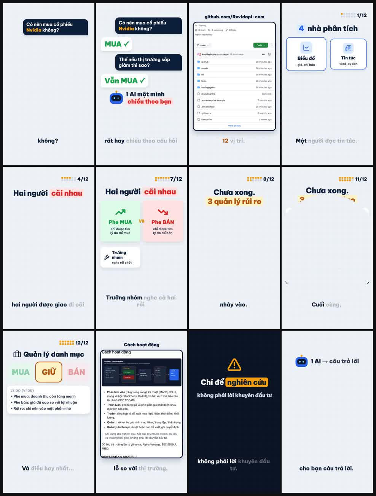
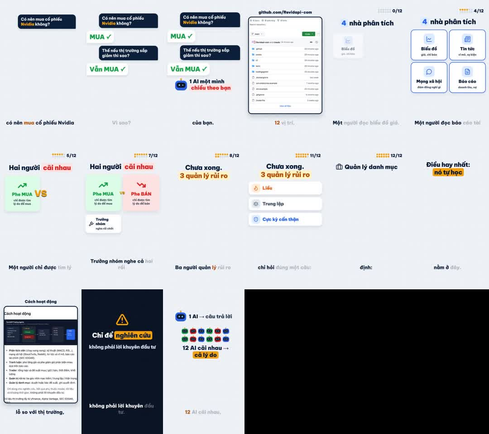
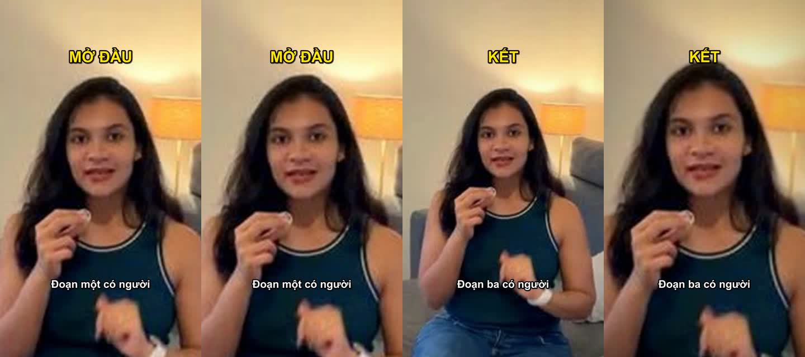

# revidapi-reup-video

Đưa một video mẫu (link TikTok, Douyin, Facebook, Instagram, YouTube hoặc file mp4). Công cụ sẽ:

1. **Tải** video qua API tải của [RevidAPI](https://revidapi.com).
2. **Cắt cảnh và chụp frame** bằng ffmpeg, kèm ảnh `tong-quan.jpg` để xem nhanh bố cục.
3. **Bóc lời** bằng Whisper (faster-whisper) chạy ngay trên máy, có mốc thời gian từng từ.
4. **Đo nhịp**: số cảnh, số giây mỗi cảnh, số từ mỗi giây, câu hook 3 giây đầu.
5. **AI viết kịch bản mới**: giữ cấu trúc và nhịp của mẫu, nhưng là nội dung mới, hoặc theo đúng yêu cầu của bạn (`--yeu-cau`).
6. **Lồng giọng** bằng thư viện giọng RevidAPI. Mỗi đoạn đọc riêng, khoảng lặng được rút cho liền mạch, không chèn im lặng nhân tạo.
7. **Dựng video dọc 1080x1920**: Ken Burns, phụ đề theo cụm, chữ lớn trên hình, tiếng vút khi chuyển cảnh, nhạc nền (tuỳ chọn).



*Toàn bộ video mẫu cắt thành một khung (`phan-tich/toan-bo.jpg`, mỗi giây một ô). Nhìn một ảnh là thấy phong cách cả bài: bố cục, màu, chữ, nhịp cảnh.*

Mục đích là học **công thức** của video mẫu, không chép hình, nhạc hay câu chữ của người khác. Hãy tôn trọng bản quyền nội dung gốc.

## Cài đặt

Cần Python 3.10+ và ffmpeg (`brew install ffmpeg` / `apt install ffmpeg` / `winget install ffmpeg`).

```bash
git clone https://github.com/Revidapi-com/revidapi-reup-video
cd revidapi-reup-video
pip install -e .
```

## Khoá API

Lấy khoá ở https://revidapi.com/dashboard, rồi chọn **một** trong hai cách:

```bash
# Cách 1: file riêng, chỉ bạn đọc được
mkdir -p ~/.revidapi && printf '%s' 'sk_...' > ~/.revidapi/khoa && chmod 600 ~/.revidapi/khoa
# Cách 2: biến môi trường cho phiên hiện tại
export REVIDAPI_KEY=sk_...
```

Công cụ **không** nhận khoá qua tham số dòng lệnh, vì như thế khoá sẽ lộ trong `ps` và lịch sử shell.

## Dùng

```bash
reup so-du                 # xem credit
reup giong-list            # danh sách giọng (voice_id)

# Từ đầu đến cổng duyệt: tải, phân tích, viết kịch bản, báo ước tính credit rồi dừng
reup chay "https://www.tiktok.com/@.../video/..." --ten mau1 \
  --yeu-cau "Giới thiệu quán cà phê sách ở Đà Lạt" --giay 45

# Xem/sửa reup-ra/mau1/kich-ban.json, rồi dựng
reup dung reup-ra/mau1 --dong-y --giong 9055 --hinh frame --nhac ~/nhac-cua-toi.mp3

# Chỉ phân tích, 0 credit
reup phan-tich mau.mp4 --ten mau2
```

Mặc định (`--hinh goc`) video mới **theo phong cách video gốc**:

- Mỗi đoạn kịch bản ứng với cảnh gốc theo đúng thứ tự.
- Cảnh **có người** (OpenCV tìm mặt/nửa thân, chạy trên máy): AI tả lại frame gốc (bố cục, góc máy, ánh sáng, trang phục) rồi vẽ **ảnh AI cùng phong cách, người khác** — không sao chép người thật. Thêm `--video-ai` để biến ảnh đó thành video AI chuyển động.
- Cảnh **không có người**: giữ frame gốc, nền mờ + phóng chậm.



*Frame từng cảnh (`tong-quan.jpg`). Video mẫu này là đồ hoạ, không có người, nên chế độ `goc` dùng lại frame và không tốn credit ảnh.*

| `--hinh` | Hình mỗi cảnh | Chi phí |
|---|---|---|
| `goc` (mặc định) | cảnh có người → ảnh AI cùng phong cách; còn lại → frame gốc | ảnh AI × số cảnh có người (+ video AI nếu `--video-ai`) |
| `frame` | frame gốc cho mọi cảnh | 0 |
| `ai` | ảnh AI cho mọi cảnh theo `mo_ta_hinh` | ảnh AI × số đoạn |
| `nen` | nền màu, chữ do phụ đề | 0 |

Nếu video mẫu đã có sẵn chữ trên hình, nên dùng `ai` hoặc `nen` để chữ không đè lên nhau.

Kết quả nằm trong `reup-ra/<ten>/`:

- `phan-tich/` (nhip.json, canh.json, loi.json, frames/, tong-quan.jpg, toan-bo.jpg)
- `kich-ban.json`
- `giong/`
- `phu-de.ass`
- file `.mp4` cuối

**Chi phí.** Phân tích, hiệu ứng và dựng chạy trên máy nên không tốn credit. Chỉ các bước sau tốn credit:

- tải video, **chỉ khi bạn đưa link**. Không muốn tốn phí tải thì tự tải video về rồi đưa đường dẫn file: `reup chay ~/Downloads/mau.mp4 ...`
- viết kịch bản (chat)
- giọng đọc, khoảng 15 credit cho 1.000 ký tự
- ảnh AI cho cảnh có người (`goc`) hoặc mọi cảnh (`ai`)
- video AI, nếu thêm `--video-ai`

Đưa file trên máy chỉ bỏ được phí tải. Viết kịch bản và giọng đọc (TTS) vẫn tính credit như thường.

Lệnh `chay` luôn dừng lại báo ước tính trước khi đọc giọng, trừ khi bạn thêm `--dong-y`.

## Hiệu ứng máy quay (tuỳ chọn, 0 credit)

Dùng bộ [claude-video-effects](https://github.com/Vibha-Ramprakash/claude-video-effects) (MIT, Vibha Ramprakash). Bộ này nhận diện khuôn mặt bằng MediaPipe rồi phóng, đẩy hoặc rọi sáng theo khuôn mặt.

```bash
reup cai-hieu-ung                                  # một lần, ~1 phút, cài vào ~/.revidapi/hieu-ung
reup chay <link|file.mp4> --hieu-ung auto --dong-y  # tự gắn lean-in / slow-push / spotlight cho cảnh có người
reup dung reup-ra/du-an --dong-y --hieu-ung ke-hoach.json   # hoặc tự viết kế hoạch
```

`ke-hoach.json` có dạng `{"effects": [{"fx": "lean-in", "start": 0.1, "end": 2.9}]}`. Tên hiệu ứng và mốc thời gian đều được kiểm, tối đa 30 hiệu ứng. Hiệu ứng chạy trên lớp hình trước khi chèn phụ đề, nên chữ không bị phóng theo. Chế độ `auto` chỉ gắn vào cảnh có người. Cảnh không có mặt người thì bộ hiệu ứng không có gì để bám.



*Hai khung trái: đoạn có lean-in. Hai khung phải: đoạn có slow-push, khung cuối đã phóng gần. Phụ đề giữ nguyên cỡ.*

Mã bộ hiệu ứng được ghim ở một commit cố định và kiểm lại mỗi lần chạy. Bộ đó tự nạp `scripts/fx_private.py` nếu có file này, nên reup từ chối chạy khi thấy file ấy. Máy không có `ffprobe` thì reup dùng một bản thay thế nhỏ đọc từ ffmpeg.

## Bảo mật

- Khoá chỉ đọc từ `REVIDAPI_KEY` hoặc `~/.revidapi/khoa`. Nếu file khoá đang mở quyền cho người khác, công cụ tự siết lại về `600`.
- Khoá **chỉ** được gửi tới `https://revidapi.com/v1`. Gọi API thì không đi theo chuyển hướng. Tải file kết quả thì **không** kèm khoá, và nếu bị chuyển hướng thì header khoá bị bỏ.
- Mọi thông báo lỗi và log đều được che khoá (`sk_***`).
- Link tải phải là `https`, không chứa tài khoản/mật khẩu, không trỏ vào IP nội bộ, loopback hay metadata cloud (chống SSRF). Mỗi lần chuyển hướng cũng được kiểm lại. File tải về có trần dung lượng (video 1GB) và được ghi ra file tạm trước.
- Tên file và thư mục lấy từ dữ liệu ngoài đều được làm sạch, không thoát ra khỏi thư mục làm việc.
- ffmpeg được gọi bằng danh sách tham số, không qua shell. Phụ đề ASS được lọc ký tự `{ } \`, nên nội dung AI không chèn được mã định dạng.
- Lời của video mẫu được coi là **dữ liệu không tin cậy**: nó được bọc trong thẻ riêng, và AI được dặn không làm theo lệnh nằm bên trong. Kịch bản AI trả về (hoặc bạn sửa tay) được kiểm lại kiểu và độ dài trước khi tiêu credit.
- Repo không kèm nhạc. Tiếng vút được tạo bằng ffmpeg khi chạy. Nhạc nền do bạn tự đưa vào và phải là nhạc bạn có quyền dùng.

Gặp lỗ hổng bảo mật, xin báo riêng qua https://revidapi.com thay vì mở issue công khai.

## Kiểm thử

```bash
pip install pytest && pytest -q
```

## Giấy phép

MIT
